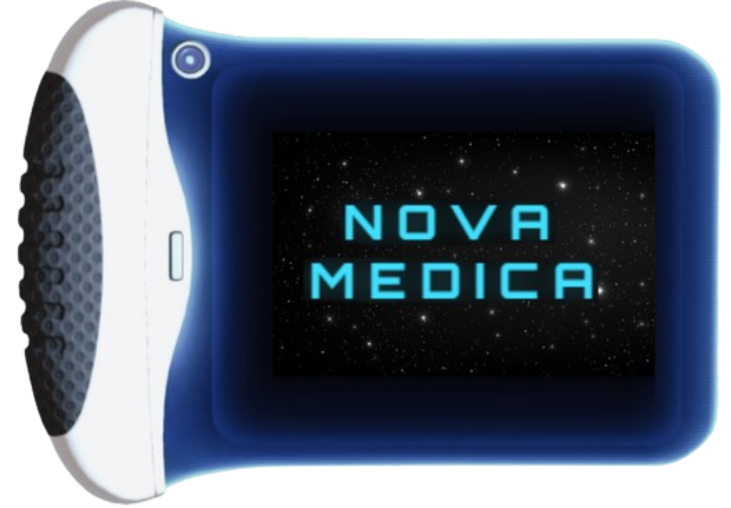

<div align="center">



<br/>
<div align="center">
<a href="https://nova-medica.vercel.app/">
  
</a>
</div>
<a href="https://nova-medica.vercel.app/"></a>

</div>
<br/>
<div align="center">

<a href="https://github.com/setlors"></a>
&nbsp;
<a href="https://github.com/d4xaris"></a>

<sub>made by</sub>

</div>

## ◈ The problem

On the way to Mars, a radio message takes up to about **20 minutes** one way. There is no doctor on board. Astronauts are not physicians, but a crewmate can collapse at any moment, and the first steps will be taken by the people standing next to them.

## ◈ The solution

**NOVA MEDICA** is a holographic PDA that works **without internet** and answers three questions:

|     | Question                          | What the app does                                        |
| --- | --------------------------------- | -------------------------------------------------------- |
| -   | **How am I doing?**               | 3D body scanner, vitals, trends and color-coded statuses |
| -   | **What do I measure, and how?**   | Guided measurements with plain-language instructions     |
| -   | **Something happened. What now?** | Emergency Mode leads a witness from alarm to protocol    |

> It does not diagnose and it is not a medical device. It estimates **urgency** and follows a protocol.

---

## ◈ Features

|     | Feature                        | What it does                                                                                                                                                                                                                                                                          |
| --- | ------------------------------ | ------------------------------------------------------------------------------------------------------------------------------------------------------------------------------------------------------------------------------------------------------------------------------------- |
| 🫁  | **Holographic Body Scanner**   | Anatomical model under a custom cyan hologram shader. A scan beam sweeps the body, organs change color with live status, and the **heart pulses at the real BPM**. Click an organ for its function, space risks and linked vitals.                                                    |
| 🩺  | **Guided Measurement**         | Seven vitals (heart rate, blood pressure, temperature, SpO₂, glucose, sleep, mood). Each has step-by-step instructions, why it matters in space, the normal range for the current environment and what to do if the value is off. Input is validated, so typos never reach the rules. |
| 🚨  | **Emergency Mode**             | Started by SOS or an automatic sensor alarm. One question per screen, 72 px buttons, timer, **CPR metronome**, voice prompts and a camera flight to the organ. Alarm cause cards show which vital triggered it, and every answer goes into a time-stamped log.                        |
| 🪐  | **Four environments**          | ISS, Orion, Moon base, Mars transit. Switching changes thresholds, risks, reminders, communication delay, medical kit and the 3D scene.                                                                                                                                               |
| 📈  | **Vitals and charts**          | Normal-range band, status-colored points, personal baseline, 24 h / 7 days / mission periods. History is kept in IndexedDB and survives a reload.                                                                                                                                     |
| ⏰  | **Reminders and Health Score** | Per-environment reminders, a Crew Health Score (0 to 100), streaks and achievements.                                                                                                                                                                                                  |
| 📚  | **Databank**                   | NASA HRP hazards and related conditions. Entries unlock as you read or as vitals change, and each one cites a source.                                                                                                                                                                 |
| 🛰   | **Ground Link**                | Offline JSON or PDF summary for the doctor on Earth. "Send to Earth" shows the simulated communication delay.                                                                                                                                                                         |
| 🧪  | **Deterministic simulator**    | Seeded data with a daily rhythm and three scenarios: `normal`, `slowDrift`, `collapse`. Same seed, same demo.                                                                                                                                                                         |

---

## ◈ Tech stack

<div align="center">


</div>

---

## ◈ Run it

### ▶ Option 1: just open it

**[nova-medica.vercel.app](https://nova-medica.vercel.app/)**

Works in a modern desktop browser (Chrome, Edge or Firefox). Use headphones or turn the sound on.

### ▶ Option 2: run locally

You need **Git** and **Bun**. Bun is a JavaScript runtime and package manager, and this project uses it instead of npm.

**1. Install Bun** (skip if `bun --version` already works):

```bash
# macOS / Linux
curl -fsSL https://bun.sh/install | bash
```

```powershell
# Windows (PowerShell)
powershell -c "irm bun.sh/install.ps1 | iex"
```

Restart the terminal afterwards.

**2. Clone and start:**

```bash
git clone https://github.com/<setlors>/nova-medica.git
cd nova-medica
bun install
bun run dev
```

Open the address printed in the terminal.

**Other commands:**

| Command             | What it does                                             |
| ------------------- | -------------------------------------------------------- |
| `bun run dev`       | Dev server with hot reload                               |
| `bun run build`     | Type-check and production build                          |
| `bun run preview`   | Serve the production build locally                       |
| `bun run typecheck` | TypeScript check                                         |
| `bun test`          | Run all tests (rules, triage, simulator, content, store) |

## ◈ Credits

- 3D anatomy model: **[Open Anatomy 3D](https://github.com/MervinR07/open-anatomy-3d)** by MervinR07, licensed under **CC BY 4.0**.
- Fonts: Orbitron, Rajdhani and Share Tech Mono (SIL Open Font License), stored locally for offline use.

---

<div align="center">

### ⚠ Disclaimer

**Demonstration prototype. Not a medical device and does not replace a doctor. All data is simulated.**

<br/>

</div>
